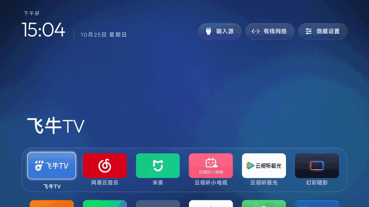
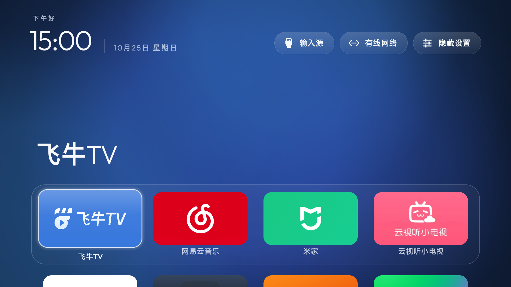
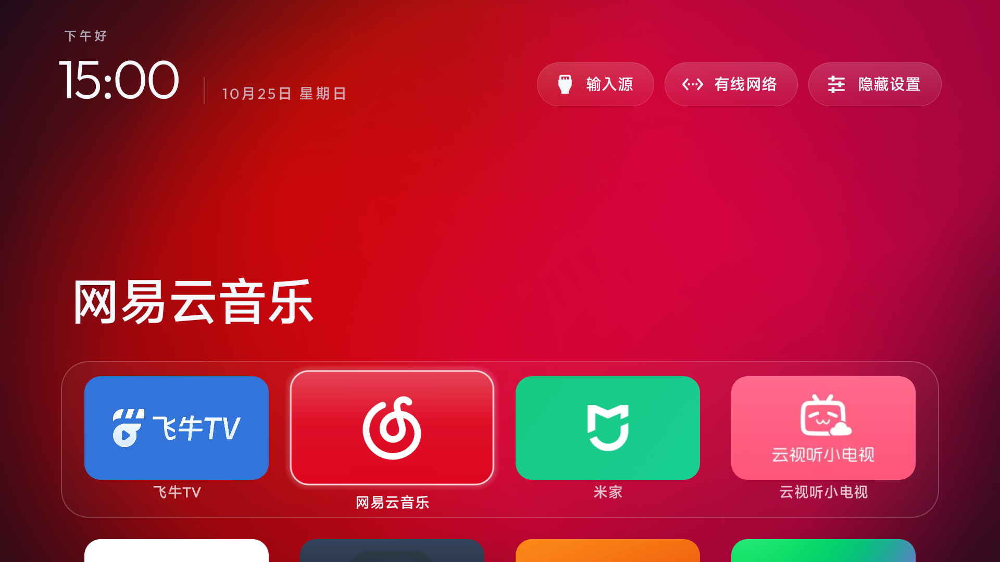
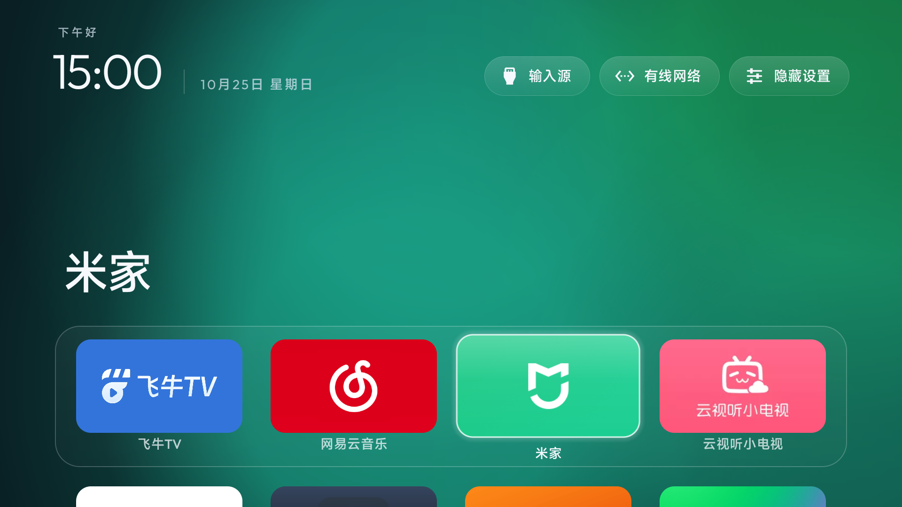
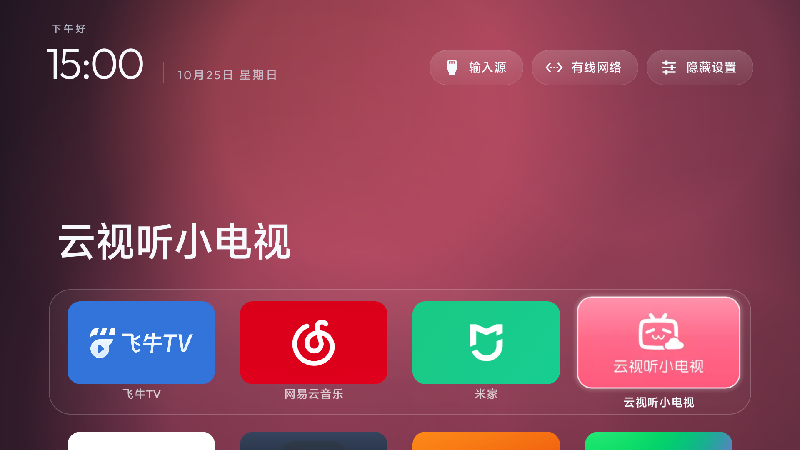
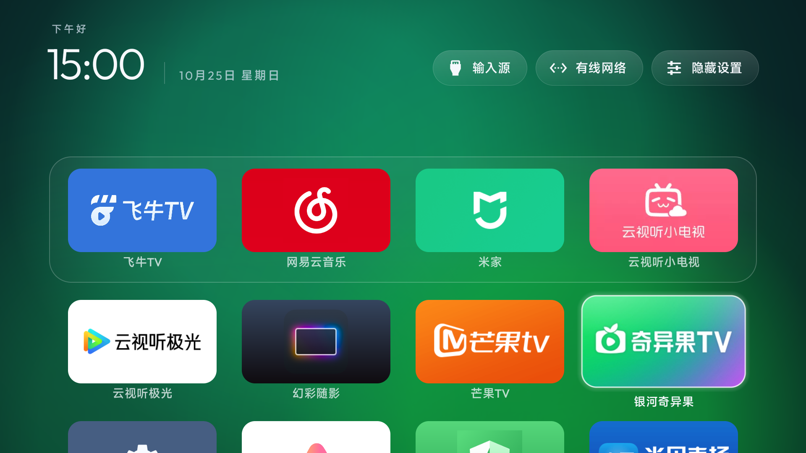
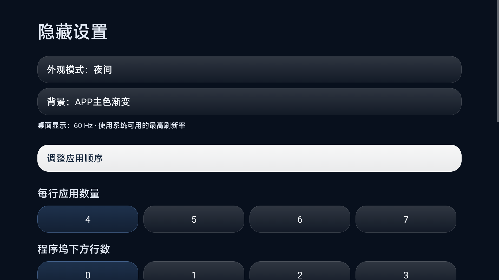
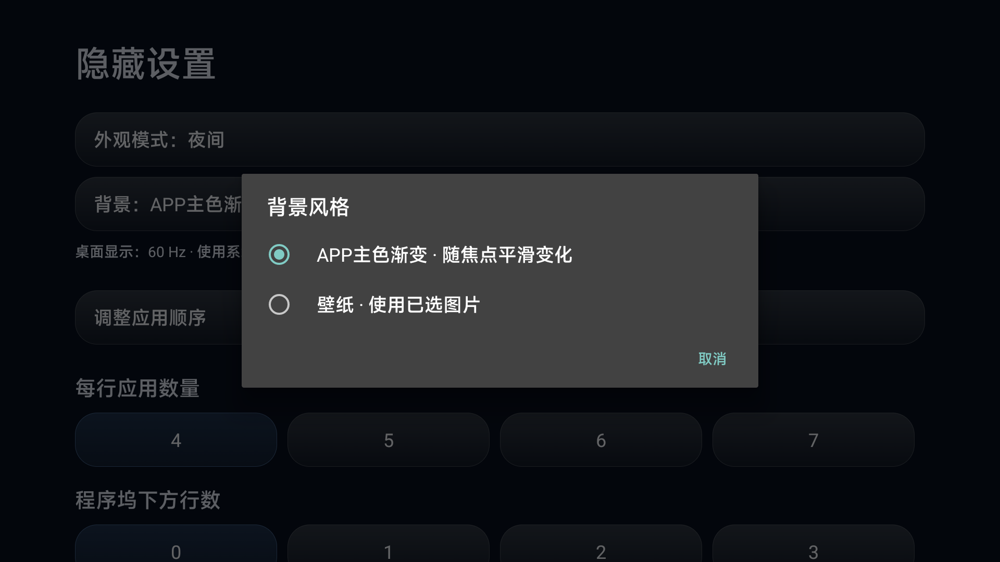
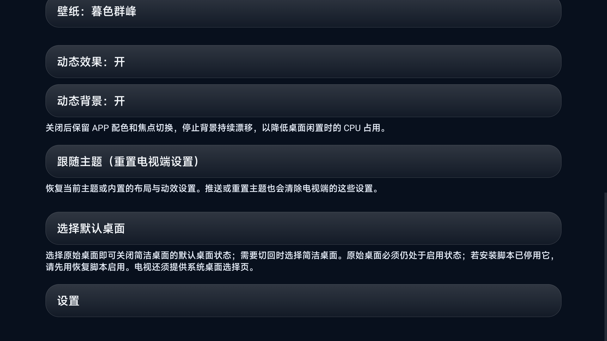
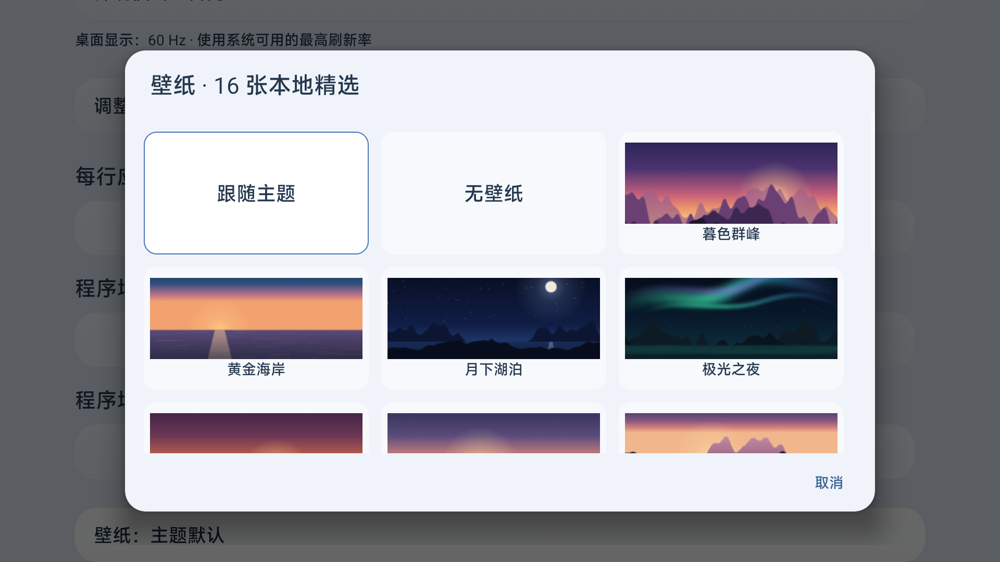

# CleanMiTV · 小米电视的干净桌面

> 基于 [Gathin23/cleanyourtv](https://github.com/Gathin23/cleanyourtv) 二次开发，针对**国行小米电视**（实测 MiTV S65 Mini LED / MiTV-MFTR0，Android 14，小米 OS3）做了本地化和视觉体验改造。



## 致敬原项目

CleanMiTV 的底子来自 **[CleanYourTV](https://github.com/Gathin23/cleanyourtv)**，作者是 [@Gathin23](https://github.com/Gathin23) 和社区贡献者们。原项目把「给安卓电视换上一个干净、无广告、可恢复的桌面」做成了一套完整、可复现的方案：

- 轻量桌面 APK（控制在 512 KiB 以内）；
- 停用应用而不是卸载，每一步都有恢复记录和一键还原；
- 覆盖 290+ 款电视机型、80+ 品牌的实机配方，还有主题、插件和完善的测试。

没有原项目的这些工作，就不会有这个 fork。本仓库同样使用 [MIT 许可证](LICENSE)，并保留原项目的全部代码、文档和历史提交。如果你的电视不是小米，请直接使用原项目。

## 我们改了什么

| 方向 | 改进 |
|---|---|
| 🎨 **APP 主色渐变背景** | 背景跟着焦点 APP 的品牌主色变化，约 680 ms 平滑过渡；快速连按以当前已显示的颜色为起点继续过渡，不会闪黑 |
| 🧠 **更准的取色** | 优先采样横幅，其次采样图标；降低角标权重，忽略透明和近灰像素。白底应用（如云视听极光）取中性银灰，不再偏蓝 |
| 🪟 **玻璃焦点与大图标** | 卡片改为更通透的浅色玻璃框，图标从约 48% 放大到 78%，应用名称移到卡片下方 |
| 🌗 **日间 / 夜间 / 自动** | 「隐藏设置 → 外观模式」可选日间、夜间或自动（07:00 切日间，19:00 切夜间） |
| 🖼️ **16 张本地壁纸** | 中文名称的缩略图网格，用遥控器即可选择；也可以选「跟随主题」或「无壁纸」 |
| ⚡ **动态背景性能优化** | 慢速背景漂移降到 20 fps 节拍，并复用颜色和几何缓存。实机静置 CPU 从约 32–35% 降到 9–12%；关闭「动态背景」后为 0%，APP 切换时的颜色过渡仍然保留 |
| 🎛️ **精简设置** | 删除「高级动态效果」（额外上浮、缩放和转场），保留普通焦点动画；新增「动态背景」独立开关 |
| 🇨🇳 **国行小米适配** | 底栏预设飞牛TV、Nova、云视听极光、云视听小电视；「设置」大齿轮直达小米原生设置；补上原厂「文件管理」入口；直播使用小米 `tvplayer` |
| 📦 **更小的包** | 只保留简体中文和英文资源，APK 约 360 KB |

同时保留了小爱同学、投屏、HDMI / CEC、幻彩随影、米家和系统更新等原厂功能，只停用了统计和诊断组件。

## 实机截图

所有截图都用 adb 直接从电视上截取，没有修图。

| 蓝色 · 飞牛TV | 红色 · 网易云音乐 |
|---|---|
|  |  |
| **绿色 · 米家** | **粉色 · 云视听小电视** |
|  |  |

| 完整应用网格 | 隐藏设置 |
|---|---|
|  |  |
| **背景风格：APP 主色渐变 / 壁纸** | **动态效果与动态背景开关** |
|  |  |



### 视频

- 横屏演示（1920×1080，27 秒）：[cleanmitv-demo-landscape.mp4](docs/cleanmitv/cleanmitv-demo-landscape.mp4)
- 竖屏版（1080×1920，适合小红书 / 抖音）：[cleanmitv-xiaohongshu-vertical.mp4](docs/cleanmitv/cleanmitv-xiaohongshu-vertical.mp4)

## 下载与安装

**安装包：** 到 [Releases](https://github.com/sqlsec/cleanmitv/releases/latest) 下载 `CleanMiTV-2.7.5-local-MiTV-OS3.apk`，或直接用仓库里的 [`release/CleanMiTV-2.7.5-local-MiTV-OS3.apk`](release/CleanMiTV-2.7.5-local-MiTV-OS3.apk)（版本 2.7.5-local）

> ⚠️ 这个包针对小米 OS3 国行固件构建。该固件只允许白名单内的包名成为第三方 Home，所以用 `-PlauncherApplicationId=com.ts.launcher` 编译。Java 代码的命名空间仍然是 `com.gathin.tvhome`，没有修改系统、固件或签名权限。如果你的电视已经装了同包名的其他应用，会出现签名冲突。其他机型请按下方步骤从源码编译默认包名版本。

1. 在电视的「设置 → 账号与安全」中打开 ADB 调试，让电视和电脑处于同一局域网。
2. 安装 APK，然后按原项目的流程切换 Home、停用原桌面。完整步骤、恢复方法和注意事项见 [原项目 CleanYourTV](https://github.com/Gathin23/cleanyourtv) 和 [docs/TROUBLESHOOTING.md](docs/TROUBLESHOOTING.md)。
3. 想恢复原厂桌面时，重新启用 `com.mitv.tvhome` 并把 Home 设回原桌面即可。停用的应用都没有被卸载。

### 从源码编译

```bash
cd launcher
# 通用包名（com.gathin.tvhome）
./gradlew assembleRelease testReleaseUnitTest lintRelease
# 国行小米 OS3（需要白名单包名）
./gradlew assembleRelease -PlauncherApplicationId=com.ts.launcher
```

底栏顺序、隐藏应用、HDMI 映射等设置都在 [`launcher/app/src/main/res/values/config.xml`](launcher/app/src/main/res/values/config.xml)，可以按自己的电视修改。

## 验证情况

- 255 项单元测试通过，`lintRelease` 通过，APK 低于原项目 512 KiB 的上限。
- 已在 MiTV-MFTR0 上实机验证：Home 接管、重启后仍保持、日夜模式、16 张壁纸、APP 主色切换、文件管理和小米设置入口，以及 HDMI 输入切换。
- 这台电视的应用显示模式只有 1080p 60 Hz，所以本项目不宣称桌面能跑到 120 / 144 Hz。CPU 数据来自电视 `top` 的短时采样，只用于同一台机器、同一场景下的前后对比。

## 许可证

MIT，与原项目一致。版权归原作者及贡献者所有，本 fork 的改动同样以 MIT 发布。
